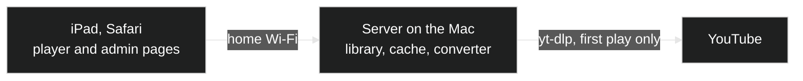

# iPad Music Box

Give an old iPad a second life as a music video player for children: no ads, no endless YouTube feed, only the songs you chose.

## Why

I had an iPad from 2013 stuck on iOS 9.3.5, the last version it can run. The YouTube app no longer installs on it, and youtube.com in its browser is too slow to use. The hardware still plays video well, though, if someone hands it a file in the right format.

So the work moved to a computer that is on anyway. A small server on the home Mac downloads songs from YouTube (with [yt-dlp](https://github.com/yt-dlp/yt-dlp)), converts them into a format the old iPad plays smoothly, and serves them on the home network. The iPad only shows a simple web page and never talks to YouTube. The kids pick from lists a grown-up made; there are no ads, no recommendations and no comments.

It should suit any iPad or iPhone stuck on an old iOS version, and any other browser on the home network works too.

## How it works

There are two parts:

- **The server** runs on a computer that stays on (a Mac here). It keeps the library (songs, playlists, tags), downloads a song the first time someone plays it, and turns it into HLS: short video chunks plus a playlist file, Apple's streaming format, which the iPad plays natively. Playback starts after the first chunks, a few seconds in, while the server prepares the rest.
- **The client** is a web page in Safari on the iPad. It is written for iOS 9 Safari (old-style JavaScript, plain HTTP) and never reloads while you browse, so the music keeps playing.



The page has two modes:

- **Player**, for the kids. Lists and tags to browse, big buttons, no typing. Tap a song and it plays, followed by the rest of its list.
- **Admin**, for grown-ups, behind a PIN. Search YouTube or paste a link, add songs to playlists, edit tags, change settings. It opens inside the player (the orange Admin button, with a number pad for the PIN) and its green Player link goes back, all in the same window, so the music keeps playing. It also works on its own at `/admin/`, from any browser on the network.

### What the kids can do

- Browse **Lists** (Loved, Played lately, All songs and your playlists) and **Tags**. Tapping a tag shows its songs; tapping another narrows to songs that have both.
- Tap a song to play it and the rest of that list. "+" adds a song to the end of the queue.
- Tap the heart to love a song; loved songs make up the "Loved" list.
- Tap the small video (or the square button) for full screen with nothing over it. A tap shows the heart, a close button, a time bar and the play buttons for a few seconds. Pinching in with two fingers also closes full screen.
- When the queue runs out, the music goes on with songs YouTube suggests after the last one (its "Mix"). They are saved in a playlist called "Related", so you can review them. Videos over 20 minutes are skipped. You can switch this off in Settings.

### What the grown-ups do

- Search YouTube. "More results" adds the next 20 below, and you can tick songs across as many pages as you like. Songs already in the library are left out.
- Or paste a YouTube link. A playlist link adds every song in it.
- Every song belongs to at least one playlist, chosen when you add it. A song taken out of its last playlist, or whose last playlist is deleted, leaves the library (the page warns first).
- Tags are added automatically (see [Automatic tags](#automatic-tags)), and you can add, rename or remove them.
- Settings: PIN, video quality (360p, 480p or 720p), how long unplayed songs are kept, the cache size, related songs on or off, and a debug log.

Adding a song saves only its title and YouTube id. Nothing is downloaded until someone plays it. The next song in the queue is fetched while the current one plays, and skipping stops the preparation of a song nobody is listening to.

## Install the server

It needs macOS, [uv](https://docs.astral.sh/uv/) and `ffmpeg`. yt-dlp also needs a JavaScript runtime for YouTube: Deno if it is installed, otherwise Node.

```sh
brew install uv ffmpeg node
git clone https://github.com/xanguera/ipad-music-box.git
cd ipad-music-box
scripts/install.sh
```

The install script sets up two launchd agents. One starts the server at login and restarts it if it stops. The other updates yt-dlp every Monday at 04:00, because YouTube changes often and an old yt-dlp is the usual reason downloads stop working. Run `scripts/update-ytdlp.sh` by hand if songs stop downloading before then. Remove it all with `scripts/uninstall.sh`; your library stays.

To run it in a terminal instead: `uv run python -m musicbox`.

The script prints the two addresses:

- Player: `http://<mac-name>.local:8080/`
- Admin: `http://<mac-name>.local:8080/admin/`

`<mac-name>` is shown by `scutil --get LocalHostName`. If the iPad cannot find that name, use the Mac's IP address instead (System Settings > Wi-Fi > Details).

The server itself is plain Python and should run on Linux too (it falls back from the Mac's hardware video encoder to a software one), but only the Mac setup is tested and only the Mac has an install script.

### Keep the Mac awake

The music stops if the Mac sleeps. On a desktop Mac, turn on System Settings > Energy > "Prevent automatic sleeping when the display is off". On a laptop, the same option is under Battery > Options and applies while it is on power. The screen can still turn off.

### First steps

1. Open the admin page and log in with PIN `1234`. Change it in Settings straight away: the PIN is 4 to 12 digits.
2. Search YouTube, tick some songs, choose a playlist for them (or type a new playlist name), and add them.
3. Open the player on the iPad and tap a song.

## Set up the iPad for a child

### Make it look like an app

In Safari, open the player address, tap Share and choose **Add to Home Screen**. It then opens full screen, without Safari's address bar.

### Lock it to the player (Guided Access)

Guided Access is built into iOS. It keeps the iPad on one app until a grown-up enters a passcode, so a child cannot leave the player, open other apps or the home screen.

1. Settings > General > Accessibility > **Guided Access**: switch it on.
2. Tap **Passcode Settings** > Set Guided Access Passcode, and choose a code the kids do not know.
3. Open the player (from the home screen icon, or in Safari).
4. **Triple-click the Home button.** The Guided Access screen appears.
5. Tap **Options** and switch off what the kids should not use. Turning off the **Sleep/Wake Button** stops them from locking the screen, and **Keyboards** stops typing (the player needs none). Leave **Touch** on.
6. Tap **Start**.

To leave Guided Access, triple-click the Home button again and enter the passcode.

### Allow only the player in Safari (optional)

To also stop the kids from browsing anywhere else when Guided Access is off: Settings > General > **Restrictions** > Enable Restrictions (set a Restrictions passcode). Under Allowed Content > **Websites**, choose **Specific Websites Only**, delete the suggested sites and add the player address. (On newer iOS versions this is under Screen Time > Content & Privacy Restrictions.)

### Keep it playing (no sleep)

- Settings > General > **Auto-Lock** > **Never**, so the screen never locks and the music never stops.
- If your iOS version shows **Display Auto-Lock** in the Guided Access settings, set it to Never too.
- Keep the iPad on its charger: with the screen always on, the battery runs down in a few hours.
- Keep the Mac awake (see above).

## Automatic tags

When songs are added, the server asks Claude for tags: a bare `claude -p` call ([Claude Code](https://claude.com/claude-code), with no tools, settings or memory) gets the titles and channel names of up to 10 new songs, plus the tags already in use, and answers 3 to 6 tags per song: artist, genre, era or style, mood, and `kids` for children's songs. A 45-song library took 26 seconds.

This is optional. It needs Claude Code installed and logged in on the server (`~/.local/bin/claude`, or set `MUSICBOX_CLAUDE` to its path). Without it, songs simply get no automatic tags. Song titles and channel names are sent to Anthropic for this. Tags you set are never removed. The player only offers tags that more than one song has.

## Where things live

- `data/library.db`: songs, playlists, tags and loved songs. The only file worth backing up.
- `data/settings.json`: PIN, cache size, how long to keep songs, video quality and the switches.
- `data/media/<video id>/`: prepared songs (`index.m3u8` plus `seg_NNNNN.ts` chunks). A song not played for 7 days is removed, and the folder is capped at 20 GB, removing the songs played least recently first (both in Settings). A removed song is prepared again when played.
- `~/Library/Logs/musicbox.log`: the server log. To trace a song that stops playing, switch on Debug log in Settings and reload the player page.

Environment variables: `MUSICBOX_DATA` (data folder, default `data`), `MUSICBOX_PORT` (default 8080), `MUSICBOX_HOST` (default `0.0.0.0`), `MUSICBOX_CLAUDE` (path to `claude`).

## Development

```sh
uv run pytest
npx acorn --ecma5 --silent musicbox/static/player.js   # the player script must stay ES5 for iOS 9
```

- `musicbox/server.py`: the web app (Flask, served by waitress): player pages, admin pages and the small API the player uses.
- `musicbox/youtube.py`: search, download and conversion. Picture and sound download at the same time; chunks are made from the picture while it is still downloading. Video the iPad can play as it is is copied; anything else is converted with the Mac's hardware encoder (H.264 Main profile, which the iPad 2 needs).
- `musicbox/db.py`: the SQLite library.
- `musicbox/tagger.py`: automatic tags.
- `musicbox/static/player.js`: the player. Safari plays the HLS songs itself; other browsers use the bundled [hls.js](https://github.com/video-dev/hls.js) (`musicbox/static/vendor/`, Apache 2.0), because Chrome's own HLS player fails on songs still being prepared.
- `plan/`: the design notes written while building it, with what was measured and what went wrong.

Everything the iPad loads must work in iOS 9 Safari: ES5 JavaScript, no CSS grid or variables, no flexbox `gap`, plain HTTP.

## A note on YouTube

Downloading videos goes against YouTube's terms of service. This project is meant for private use at home, for music you could watch on YouTube anyway. Please respect the artists: if your family loves a song, support the people who made it.

## Licence

MIT, see [LICENSE](LICENSE). hls.js is Apache 2.0 (`musicbox/static/vendor/hls.LICENSE`).
