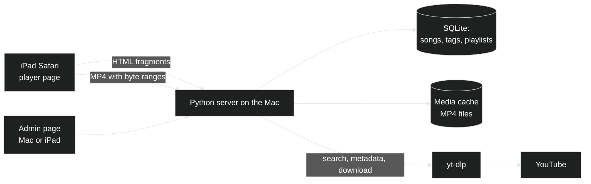

# iPad music server — plan

## TL;DR

The kids use an old iPad 2/3 (stuck on iOS 9.3.5) to pick and play music videos. The music matters more than the picture.

A small server runs on the always-on Mac. It keeps a library of songs: their YouTube ids, titles, thumbnails and tags. It also keeps the playlists. Nothing is downloaded when a song is added. The first time a song is played, the Mac fetches it with yt-dlp as a small 360p MP4, keeps it, and sends it to the iPad. There are no ads, because the iPad never talks to YouTube.

There are two web pages, both plain enough for iOS 9 Safari:

- **Player** (for the kids): browse by tag or playlist, search, play, and a queue that moves to the next song by itself.
- **Admin** (for Xavi, behind a PIN): search YouTube, add songs, tag them, build playlists. It works on the Mac and on the iPad.

The one design point that matters most: the player must keep playing while the kids browse. So the page that holds the player never reloads. Browsing swaps the content under it.

## Decisions taken

- [x] Video plays on the iPad itself. Sound matters most; the picture can be low quality.
- [x] Songs are downloaded on demand, at first play, not when added to the library.
- [x] Playlists and tags are managed on the Mac server through an admin web page, also usable from the iPad.
- [x] The kids only see the library, not all of YouTube.
- [x] The screen never locks (iPad setting, see Setup).

## Constraints from the iPad (iOS 9.3.5 Safari)

- Old JavaScript only (ES5): no arrow functions, `let`/`const`, `fetch`, Promises in our code. Use `XMLHttpRequest`. No build step; hand-written JS.
- CSS: flexbox works; CSS grid and CSS variables do not. Keep layouts simple.
- Video: H.264 + AAC in MP4, at most 720p. We serve 360p (yt-dlp format 18, or 360p H.264 merged with AAC audio).
- The server must support HTTP Range requests (byte ranges), or Safari will not play the MP4.
- Plain HTTP on the home network. iOS 9 does not trust today's Let's Encrypt certificates.
- 512 MB / 1 GB of RAM: page sizes small, thumbnails small (YouTube `mqdefault`, 320x180), lists paged.
- A video that starts without a tap is restricted. Playing the next item from the `ended` event in the same `<video>` element usually works after the first tap. **Must be tested first on the real iPad.**
- No iOS 9 simulator exists in current Xcode. All device testing is on the real iPad.

## Architecture

- **Language:** Python, because yt-dlp is a Python library we can call directly (search, metadata and download without shelling out).
- **Web framework:** Flask with Jinja templates. Pages are built on the server. Simple, synchronous, enough for one household.
- **Data:** SQLite file. Tables: `songs` (youtube id, title, channel, duration, thumbnail, added date), `tags`, `song_tags`, `playlists`, `playlist_items` (ordered). Full-text search (SQLite FTS5) over title, channel and tags.
- **Media cache:** a folder of `<youtube_id>.mp4`. Size cap (default 20 GB), oldest-played deleted first.
- **Downloads:** a small background worker (thread + queue). One download at a time.
- **Thumbnails:** loaded by the iPad directly from `i.ytimg.com`. If that proves slow, proxy and cache them on the Mac.
- **Runs as:** a launchd agent on the Mac, started at login, restarted if it dies. Reachable at `http://<mac-name>.local:8080`.
- **Dependencies:** `uv` for the Python environment, `ffmpeg` (installed) for merging audio and video, a JavaScript runtime for yt-dlp's YouTube support (Node is installed; Deno is yt-dlp's default).

### Player page: keep the music going while browsing

The outer page holds the `<video>` element, the queue and a "now playing" bar. It loads once. Every link inside the browse area is caught by a little ES5 script. The script asks the server for that page's HTML fragment (`XMLHttpRequest`) and swaps it into the browse area. The server renders both full pages and fragments from the same templates.

- Queue lives in the page (and in `localStorage`, so a reload restores it).
- On `ended`: play the next item in the same `<video>` element.
- While a song plays, tell the server to prepare the next one, so it is ready when needed.
- A "music only" toggle hides the picture. The sound is unchanged.

### Playing a song that is not downloaded yet

1. iPad asks `/media/<id>.mp4`.
2. If the file is in the cache, the server sends it, with byte ranges.
3. If not, the server starts the download and the iPad shows "getting it ready…" and polls a status URL every second. A 4-minute song at 360p is about 10–20 MB; expect roughly 5–15 seconds.
4. When the file is ready, the player starts it.

Streaming the file while it is still downloading is possible, but complex with byte ranges. Not in the first version.

### iPad UI for a big library

- **Home:** large tiles. A row of playlists, then a cloud of tags as big buttons (for example: a kid's name, "dance", "car songs", artist names, languages).
- **Tag filter:** tapping a tag shows its songs. Tapping a second tag narrows to songs with both tags. The chosen tags show as removable chips on top.
- **Search:** one box. It matches title, channel/artist and tags, and returns songs, playlists and tags in one result page.
- **Song list:** thumbnail, title, artist. Tap = play now. A second button = add to queue.
- **Paging:** 30 items per page with "more" at the bottom, to keep memory low.
- **Big touch targets** (at least 44 px), large text. Usable by a child.
- **Recently played** list on the home page.

### Admin page

- Behind a PIN, stored in a cookie for 30 days.
- **Search YouTube** (yt-dlp `ytsearch20:`), show results with thumbnails. One tap adds a song to the library, with optional tags and playlist. Adding fetches metadata only, no download.
- **Add by link:** paste a YouTube video or playlist link. A playlist link imports all its songs.
- **Edit:** rename a song, change its tags, delete it.
- **Playlists:** create, rename, reorder songs (up/down buttons; dragging is unreliable on iOS 9), delete.
- **Status:** cache size, downloads in progress, last errors, yt-dlp version.
- Same iOS 9 limits as the player, so it also works on the iPad.

## Setup on the iPad (no code)

- Settings > General > Auto-Lock > **Never**. Keep the iPad on its charger.
- Settings > General > Accessibility > **Guided Access** on, with a passcode. Start it in Safari: the kids cannot leave Safari, and you can lock the address bar.
- Save the player page to the home screen ("Add to Home Screen"), so it opens full screen like an app.
- Optional: pair a Bluetooth speaker.

## Steps

### Phase 0 — prove the risky parts on the real iPad
- [x] Install yt-dlp in a uv project; download one song as 360p H.264/AAC MP4.
- [x] Minimal Flask server that serves that MP4 with byte ranges.
- [ ] Test page on the iPad: tap to play, then the next song starts by itself from `ended`.
- [ ] Same test with the "music only" view.
- [ ] Same test after switching to another Safari tab and back, and with Guided Access on.
- [ ] Check that browsing (swapping the fragment) does not stop playback.
- [ ] Decide: if auto-next fails, fall back plan (join the queue into one longer file on the server, or show a big "next" button).

### Phase 1 — library and player
- [x] SQLite schema and data layer.
- [x] Download worker, cache with size cap, status endpoint.
- [x] Player outer page: video, queue, now playing bar, fragment loading.
- [x] Home, tag filter, search, song list, playlist pages.
- [x] Prefetch the next song.

### Phase 2 — admin
- [x] PIN login.
- [x] YouTube search and add; add by link; playlist import.
- [x] Tag editing; playlist editing.
- [x] Status page.

### Phase 3 — run it for real
- [x] launchd agent; logs to `~/Library/Logs/musicbox.log`.
- [x] Weekly yt-dlp update (YouTube changes often break older versions).
- [x] Back up the SQLite file (the cache can be rebuilt). Left to Time Machine; README says `data/library.db` is the file that matters.
- [x] README: how to start, stop, update, and set up the iPad.

## Risks

- **Auto-next on iOS 9** may need a fallback. Tested in Phase 0 before anything else is built.
- **yt-dlp breaks** when YouTube changes. Weekly updates fix most of it. A song that fails shows a clear message, and the player skips to the next.
- **YouTube may throttle or block** heavy downloading from one address. Our volume (a few songs a day, cached) is low.
- **Terms of use:** downloading from YouTube is against YouTube's terms. This is private use at home, nothing is shared outside the house.

## Open questions

- Should each kid have their own favourites, or is one shared library enough? (Default: shared.)
- Cache cap size? (Default: 20 GB.)

## Review

Status on 2026-11-05: Phases 1 to 3 are built and tested on the Mac. The Phase 0 checks that need the real iPad are still open (unticked above). Nothing is installed as a launchd agent yet; that is `scripts/install.sh`.

What was verified:
- 20 automated tests pass (`uv run pytest`): search, tags, playlists, paging, fragments, byte ranges, admin PIN, adding and editing.
- The player script parses as strict ES5 (`acorn --ecma5`).
- End to end against real YouTube: admin search, add by link with tags and playlist, download on first play (about 8 to 10 seconds per song), byte-range replies (206), files are H.264 Main level 3.0/3.1 with AAC and the index at the start of the file.
- In desktop Chrome: playlist opens without a page reload, Play all waits for the download and then plays, music keeps playing while browsing, the next song starts by itself at the end, search, "+" and the queue panel work, no console errors.

Changes from the plan:
- Format: YouTube rarely offers its old 360p combined format now, so the fallback is 480p H.264 + AAC (about 10 to 15 MB per song). Still within the iPad 2 limit.
- Thumbnails go through the Mac and are cached there, instead of loading from YouTube. iOS 9 may not trust today's certificates, and it saves the iPad work.
- Search uses plain substring matching instead of SQLite full-text search. It also matches the middle of words, and is fast enough for a home library.
- The "music only" toggle was dropped. The video is small in the bottom bar by default, with a button to make it big. Hiding the video does not change how iOS treats playback.
- Found and fixed: yt-dlp runs Node in a locked-down mode, and a preload script in NODE_OPTIONS (set by some terminals) made it fail, so some videos showed as "not available". The server now drops NODE_OPTIONS for yt-dlp.

Follow-up after first use (same day):
- Quality was too low: YouTube's combined 360p file was being picked first. Now the best H.264 up to 720p at 30 fps is taken, with 128 kbit/s AAC. YouTube often has 720p only in High profile, which the iPad 2 cannot decode, so the Mac converts such files to Main profile 3.1 with its hardware encoder (about 12 s for a 4-minute song). A first play now takes about 20 s.
- Next/previous seemed blocked: the old song kept playing while the new one downloaded, and downloads ran one at a time, so a skipped long concert kept downloading in front of the wanted song. Now a skip pauses the old song at once and cancels any download (or conversion) the player no longer needs. Previous works while a song is still loading.
- Admin YouTube results got a "Tick all" box.
- 23 tests pass.

Still to test on the iPad:
- First tap plays (the silent-clip unlock), and auto-next works without a tap.
- Playback continues with Guided Access on.
- Layout and touch targets on the real screen, portrait and landscape.
